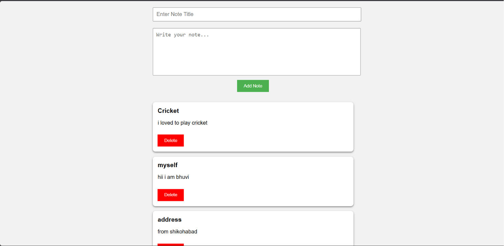

# React + Vite

This template provides a minimal setup to get React working in Vite with HMR and some ESLint rules.

Currently, two official plugins are available:

- [@vitejs/plugin-react](https://github.com/vitejs/vite-plugin-react/blob/main/packages/plugin-react) uses [Oxc](https://oxc.rs)
- [@vitejs/plugin-react-swc](https://github.com/vitejs/vite-plugin-react/blob/main/packages/plugin-react-swc) uses [SWC](https://swc.rs/)

## React Compiler

The React Compiler is not enabled on this template because of its impact on dev & build performances. To add it, see [this documentation](https://react.dev/learn/react-compiler/installation).

## Expanding the ESLint configuration

If you are developing a production application, we recommend using TypeScript with type-aware lint rules enabled. Check out the [TS template](https://github.com/vitejs/vite/tree/main/packages/create-vite/template-react-ts) for information on how to integrate TypeScript and [`typescript-eslint`](https://typescript-eslint.io) in your project.

<!-- Add screenshot -->

## Screenshot

## Deploy MicroNotes

### 1. Backend (Render)
Netlify hosts the Vite frontend; the Express API must be hosted separately.
1. Push this repository to GitHub.
2. In Render, create a **New Web Service** from this repository. Set **Root Directory** to `backend`, **Build Command** to `npm install`, and **Start Command** to `node server.js`.
3. After deployment, copy the backend service URL (for example, `https://micronotes-api.onrender.com`).

### 2. Frontend (Netlify)
1. In Netlify, **Add new site → Import an existing project** and select the GitHub repository.
2. The included `netlify.toml` configures the base directory as `frontend`, build command as `npm run build`, and publish directory as `dist`.
3. In **Site configuration → Environment variables**, add `VITE_API_URL` with the backend URL from Render (no trailing slash).
4. Trigger a new deploy.

### Notes
- Do not commit `.env` files containing secrets. `frontend/.env.example` is only a template.
- The current backend stores notes in an in-memory array, so notes disappear when the server restarts. Use a database for persistent storage.
